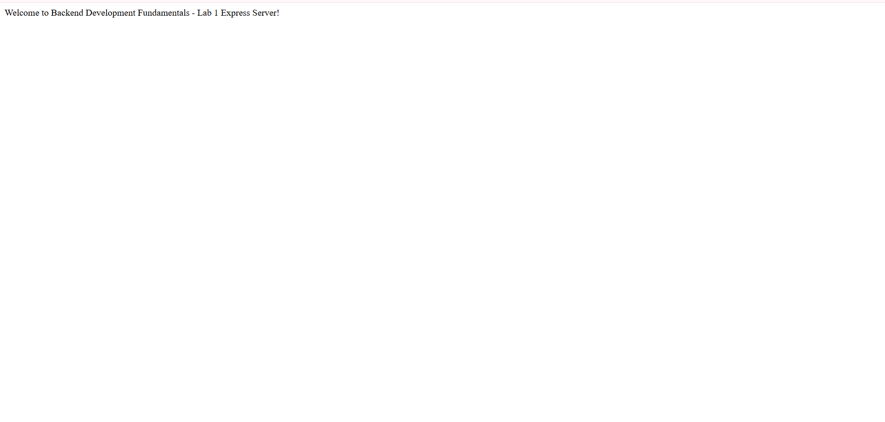
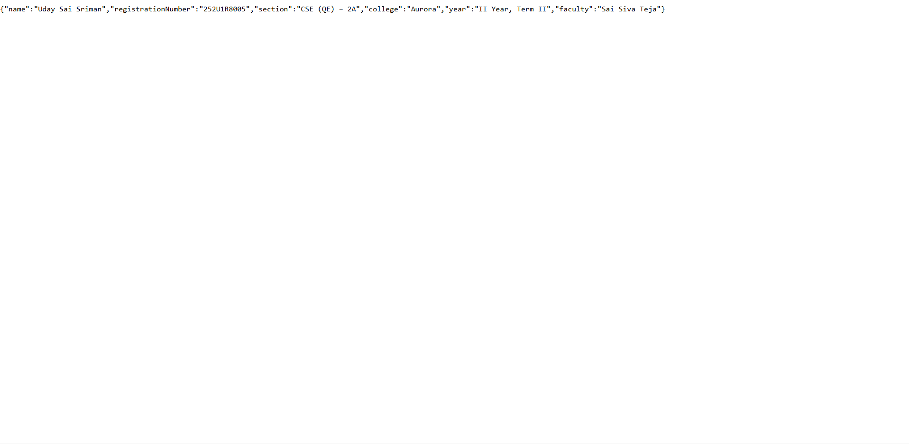
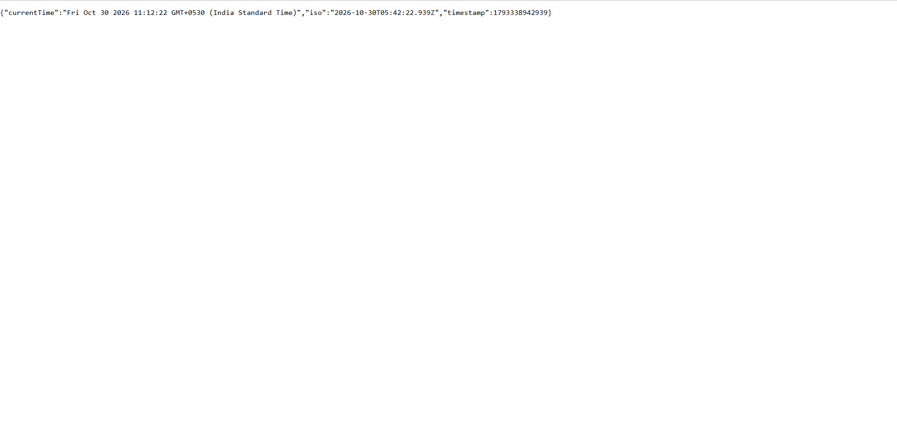

# Lab 1 Route Verification Screenshots

This directory contains browser verification screenshots for all implemented endpoints:

### 1. Root Endpoint (`GET /`)

---

### 2. About Endpoint (`GET /about`)

---

### 3. Time Endpoint (`GET /time`)

---

### 4. 404 Response for Unknown Routes (`GET /invalid-route`)
