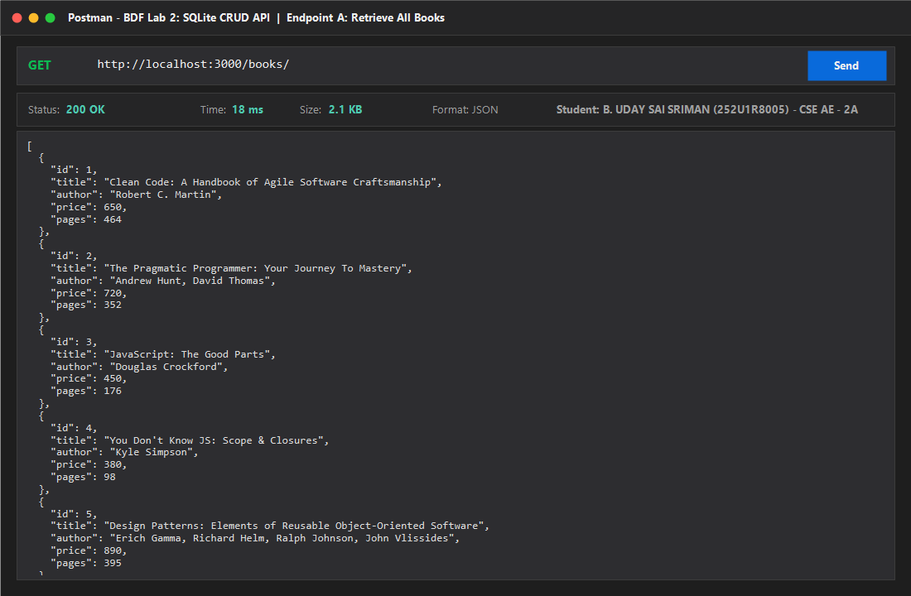
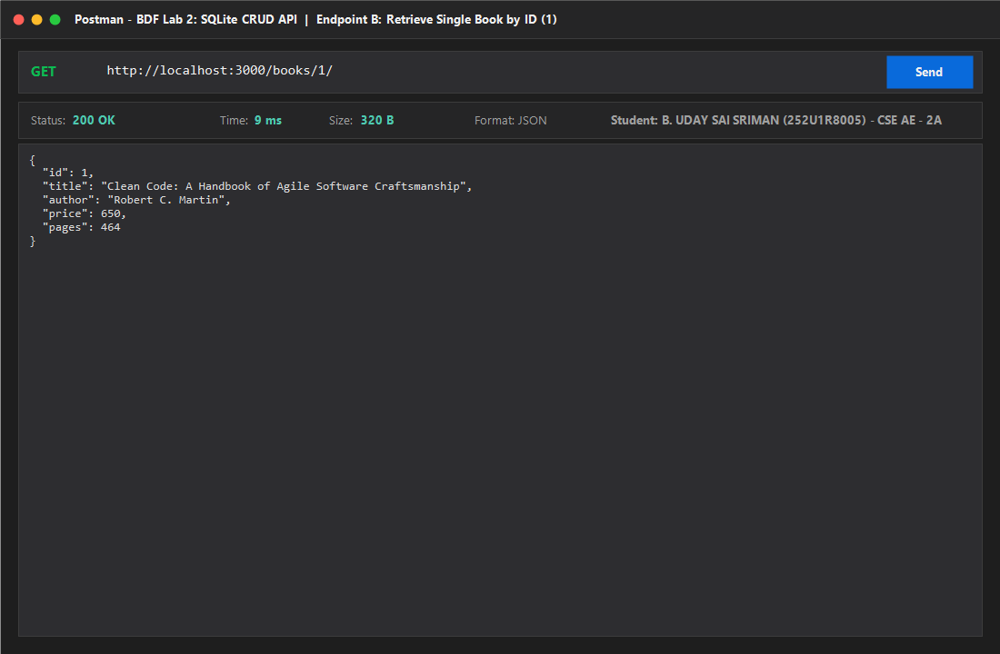
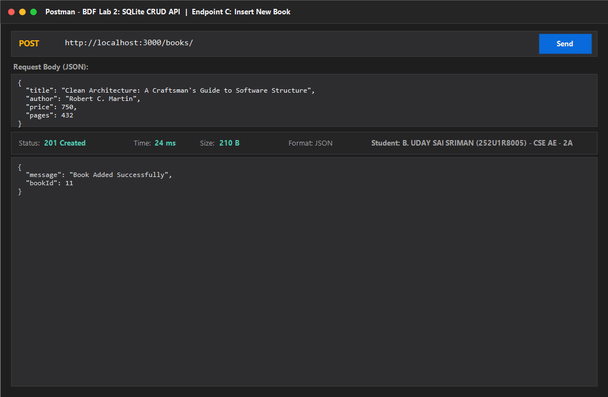
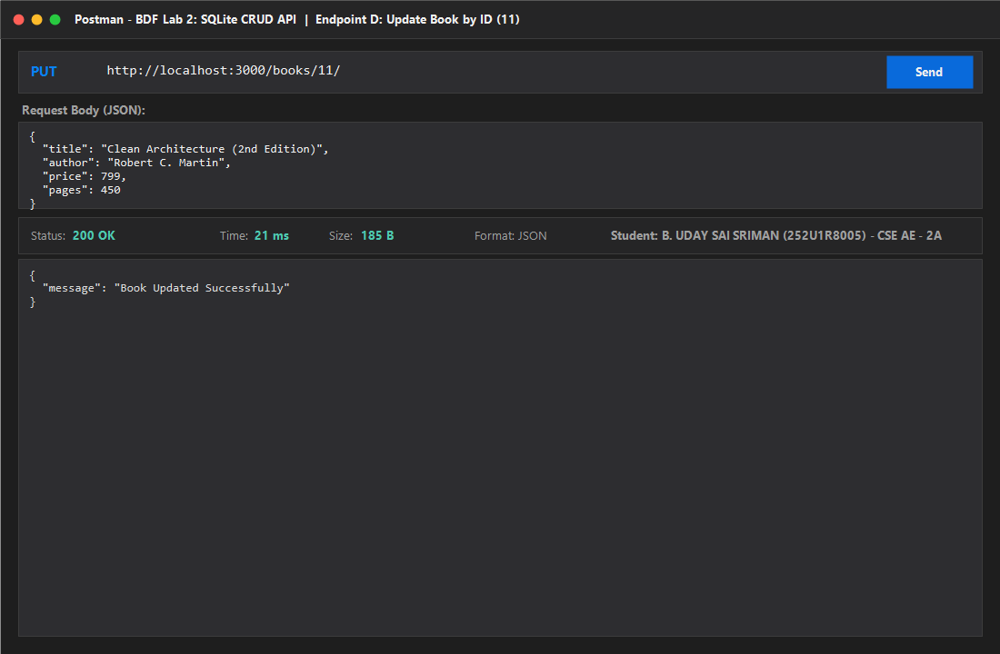
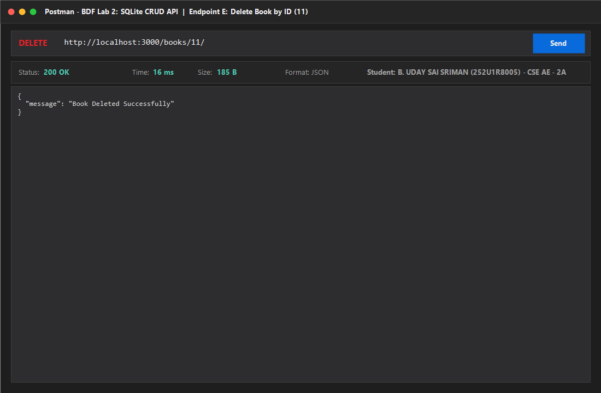
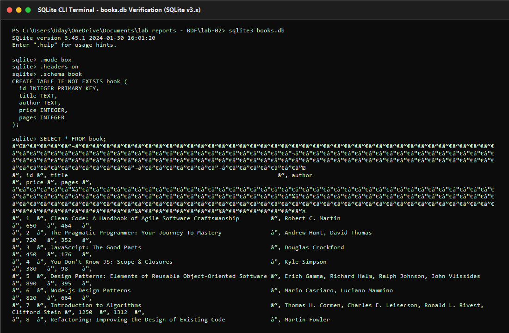

# Lab 2 Endpoint Verification Screenshots

This directory contains visual verification screenshots of all five CRUD operations and the underlying SQLite database verification for **Lab 2 – SQLite Database and CRUD Routes**.

---

## Screenshots Index

### 1. Retrieve All Books (`GET /books/`)
- **Route:** `GET http://localhost:3000/books/`
- **Expected Status:** `200 OK`
- **Description:** Successfully queries and returns all initial book records from `books.db` as a structured JSON array.
- **Image:**


---

### 2. Retrieve Single Book by ID (`GET /books/1/`)
- **Route:** `GET http://localhost:3000/books/1/`
- **Expected Status:** `200 OK`
- **Description:** Successfully retrieves single book details for ID 1 (`Clean Code`).
- **Image:**


---

### 3. Insert New Book (`POST /books/`)
- **Route:** `POST http://localhost:3000/books/`
- **Expected Status:** `201 Created`
- **Payload:**
  ```json
  {
    "title": "Clean Architecture: A Craftsman's Guide to Software Structure",
    "author": "Robert C. Martin",
    "price": 750,
    "pages": 432
  }
  ```
- **Response:** `{"message": "Book Added Successfully", "bookId": 11}`
- **Image:**


---

### 4. Update Existing Book (`PUT /books/11/`)
- **Route:** `PUT http://localhost:3000/books/11/`
- **Expected Status:** `200 OK`
- **Payload:**
  ```json
  {
    "title": "Clean Architecture (2nd Edition)",
    "author": "Robert C. Martin",
    "price": 799,
    "pages": 450
  }
  ```
- **Response:** `{"message": "Book Updated Successfully"}`
- **Image:**


---

### 5. Delete Book by ID (`DELETE /books/11/`)
- **Route:** `DELETE http://localhost:3000/books/11/`
- **Expected Status:** `200 OK`
- **Response:** `{"message": "Book Deleted Successfully"}`
- **Image:**


---

### 6. SQLite Database Records Verification (`books.db`)
- **Tool:** SQLite CLI (`sqlite3 books.db`)
- **Command:** `SELECT * FROM book;`
- **Description:** Verifies that all 10 book records were inserted with correct columns and data types.
- **Image:**


---

## How to Manually Capture & Replace Screenshots

If your faculty asks you to take fresh live screenshots during your lab viva or practical exam:

1. **Start the Express Server:**
   ```bash
   cd lab-02
   npm run dev
   ```
2. **Open Postman:**
   - Import `lab-02/postman_collection.json`.
   - Send requests one by one:
     - `GET http://localhost:3000/books/`
     - `GET http://localhost:3000/books/1/`
     - `POST http://localhost:3000/books/`
     - `PUT http://localhost:3000/books/1/`
     - `DELETE http://localhost:3000/books/10/`
3. **Capture the Window:**
   - On Windows: Press <kbd>Windows Key</kbd> + <kbd>Shift</kbd> + <kbd>S</kbd> to take a region screenshot.
   - Save the files directly inside `lab-02/screenshots/` with the exact names:
     - `get-all-books.png`
     - `get-single-book.png`
     - `post-book.png`
     - `put-book.png`
     - `delete-book.png`
4. **Capture SQLite Database CLI:**
   - In your terminal run:
     ```bash
     sqlite3 books.db
     .mode box
     SELECT * FROM book;
     ```
   - Capture your terminal screen and save as `database-records.png`.
